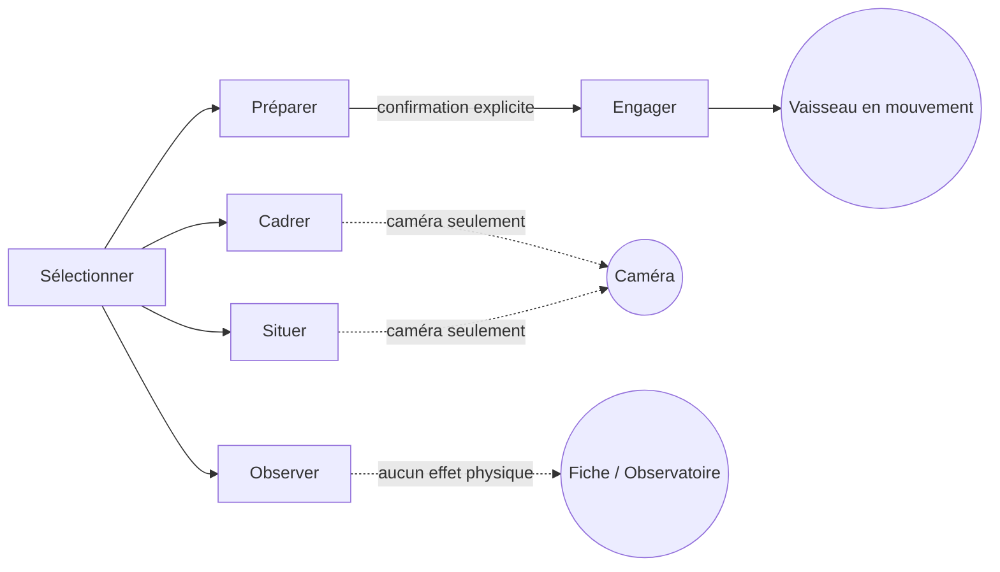
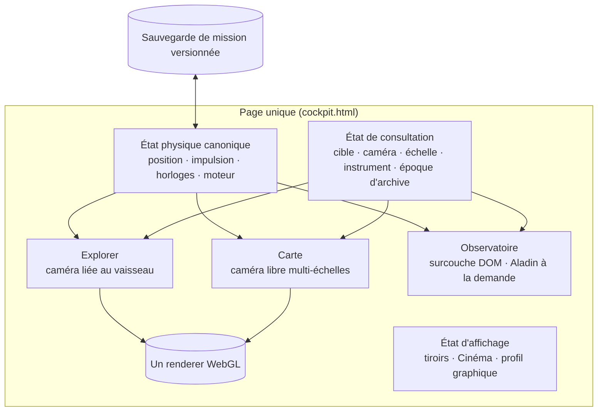

# Odyssée — Réponse du Head of UI/UX à la Note Master V1

**Auteur :** Claude, Head of UI/UX · **Date :** 18 novembre 2026
**Répond à :** [PROJET_NOTE_MASTER_HEAD_UIUX_V1.md](./PROJET_NOTE_MASTER_HEAD_UIUX_V1.md), validée par le propriétaire
**Base relue :** `main` `8a18c37` ; version publiée **v55** (`e538e64`), vérifiée sur le Chrome Iris Xe du propriétaire le 18 novembre
**Nature :** avis contradictoire et proposition de conception. **Aucune implémentation, aucun déploiement** ne découle de ce document sans accord explicite du propriétaire. Les mesures citées sont distinguées des propositions : **[M]** mesuré (avec conditions), **[C]** lu au code, **[P]** proposition du Head.

---

## 0. En une page

1. **La Note est juste, et je la signe sur le fond.** J'adopte la vision, la gouvernance et **14 des 16 arbitrages sans réserve**. Deux demandent une précision, pas un renversement : D9 (temps partagé) est aujourd'hui impossible à tenir tant que la Carte cosmique est une page séparée, et D10/D15 (événements critiques) restent indéfinis tant qu'on n'a pas la liste des événements.
2. **Ma décision d'architecture : un seul moteur, une seule page pour Explorer et la Carte**, l'Observatoire en surcouche de cette même page. Raison mesurée : chaque changement de page relance le cockpit, soit **≈ 19,7 s** sur Iris Xe **[M]**, dont 10,5 s de préparation GPU. Pas de framework ni de réécriture : le cockpit héberge **déjà** trois vues (Cockpit, Vaisseau 3D, Carte galactique 3D) dans **un seul renderer** **[C]**.
3. **Le plein écran ne doit rien coûter de plus au GPU, et c'est réglable.** Le moteur borne déjà les pixels rendus (`renderPixelRatio`) **[C]**. Un budget « Immersion » égal au coût actuel (≈ 825 000 pixels) donne un ciel plein écran au même prix, avec une image un peu moins piquée (DPR interne ≈ 1,1 au lieu de 1,5). C'est un compromis à arbitrer par le propriétaire (§ 9, Q3).
4. **Le ciel visible double.** Même méthode de mesure pour tout le monde, fenêtre 1280 × 585 **[M]** : cockpit actuel **36–38 %** de ciel non occulté ; maquette V3.1 Immersion **74,9 %** ; prototype Qwen V2 Immersion **77,3 %** ; modes cinéma 98–99 %.
5. **Je corrige mes propres maquettes V3.1** : leur HUD sur deux rangées est trop haut. Je reprends l'idée de Qwen (télémétrie en bandeau supérieur, barre de pilotage fine en bas) et je vise **≥ 80 % de ciel en Immersion**.
6. **Première tranche proposée : « Explorer immersif » en option réversible**, à côté de l'interface actuelle, sur les mêmes éléments DOM (déplacés, pas réécrits), précédée d'une tranche 0 d'instrumentation. Rien n'est retiré tant que la matrice de préservation (§ 6) n'est pas verte.
7. **Trois questions seulement pour le propriétaire** (§ 9).

---

## 1. Les 16 arbitrages

| N° | Avis | Commentaire du Head |
|---|---|---|
| D1 Hybride réalisme + immersion | **D'accord** | C'est la bonne tension. Elle se règle par la provenance affichée, pas par des compromis sur le rendu. |
| D2 Immersion scientifiquement contrainte par défaut | **D'accord, à préciser** | J'ajoute une règle : tout traitement d'image actif (exposition automatique, couleurs « scientifiques », amplification des sources ponctuelles) est **annoncé sur la scène**, comme aujourd'hui la légende « Sources ponctuelles amplifiées ». |
| D3 Open world libre | **D'accord** | Conséquence UX : aucun écran d'accueil bloquant. On ouvre sur le ciel ; l'aide est un bouton « ? » et un « Qu'est-ce que je regarde ? » déjà existant. |
| D4 Déplacements hybrides | **D'accord** | Le passage fictif garde son statut violet « Fiction » à chaque écran et dans le journal. |
| D5 Manuel ≡ assisté | **D'accord** | Parcours 6 de la Note à garder en régression. |
| D6 Exploration planétaire bornée | **D'accord** | Hors périmètre de la refonte. Aucune maquette d'atterrissage avant d'avoir des données de relief. |
| D7 Entrée rapide exploitable | **D'accord, à définir** | Je propose une définition opérationnelle (§ 5.4) : ciel affiché, commandes de vol et recherche utilisables. Les variantes optiques secondaires arrivent ensuite, avec une mention « préparation en cours » visible. |
| D8 Trois espaces continus | **D'accord** | Voir § 4 : c'est la raison du choix « une page, un moteur ». |
| D9 Temps partagé, contrôle partout | **D'accord, mais intenable aujourd'hui** | Sur la page Structures cosmiques (`cosmos.html`), la simulation du vaisseau ne tourne pas : elle est sauvegardée et figée **[C]**. Pause et facteur de lecture ne peuvent donc pas y être « partagés ». Seule l'intégration de la Carte au cockpit tient D9. |
| D10 Assistance temporelle | **D'accord sur le principe, liste à fixer** | Je propose une liste de départ (§ 3.5). Le propriétaire n'a qu'à valider le réglage par défaut (§ 9, Q2). |
| D11 Observatoire évolutif | **D'accord** | Fiche légère dans le ciel, puis poste scientifique. Aladin Lite seulement à la demande et après vérification des licences. |
| D12 Carte libre multi-échelles | **D'accord** | Caméra libre, vaisseau marqué ▲, bouton « Retour au vaisseau » qui ne déplace rien. |
| D13 Préparer ≠ engager | **D'accord, essentiel** | « Engager » devient le **seul verbe qui fait bouger le vaisseau**, toujours confirmé (§ 3.2). |
| D14 Qualité adaptative | **D'accord** | Les profils existent **[C]**. J'y ajoute un budget de pixels propre au mode Immersion (§ 5.3). Les modèles physiques ne dépendent jamais du profil. |
| D15 HUD contextuel, Cinéma épuré | **D'accord** | Le statut de provenance reste visible même en Cinéma : c'est la frontière entre émerveiller et tromper. |
| D16 Open source à terme | **Hors de mon rôle** | Aucune action UX. Je signale seulement que les textures et catalogues ont leurs propres licences, qui contraindront l'Observatoire. |

---

## 2. Critique des audits

### 2.1. Constats prouvés, déjà corrigés et vérifiés sur Iris Xe

| Constat | Auditeur | État |
|---|---|---|
| Recherche sans classement (« Mars » / « Marsic ») | Astra | Corrigé en `701ed53`, en ligne en v55. Vérifié : « Mars » → Mars, Marsic ; « HIP 32349 » → Sirius ; « proxima » → l'étoile avant ses planètes **[M]**. |
| Fausse erreur WebGL de la Carte (`ResizeObserver`) | Qwen | Corrigé en `701ed53`, en ligne en v55. Notification injectée : pas de panneau, avertissement en console ; vraie erreur et perte de contexte toujours affichées **[M]**. |
| Barre Mission sur deux rangées | relais du 17/11 | Corrigé en `b2bc90e`, en ligne en v54. Barre 64 px, ciel 471 px **[M]**. |

### 2.2. Affirmations fausses ou non établies

- **« Deux contextes WebGL, cockpit + vaisseau » (Mistral)** : un seul `<canvas>` dans le document **[M]**, et la vue extérieure passe par une cible de rendu du même moteur (`spacecraft.js`) **[C]**. Non établi.
- **« Le réseau est le goulot du démarrage » (lecture Qwen/Astra/Kimi des 26,7 Mo)** : 4,6 Mo transférés en 1,2 s **[M]**. Les 26,7 Mo sont la taille décodée. Le vrai poste est la préparation GPU (10,5 s, 53 %), puis 2,3 s de préparation processeur non tracée.
- **« L'immersion ne coûte que du DOM » (GLM)** : faux. Passer le ciel de 780 × 471 à 1280 × 535 multiplie les pixels par 1,86 au même DPR. Mais c'est maîtrisable (§ 5.3).
- **« 37 s de démarrage » (GLM)** : borne supérieure tirée de mon propre relais, pas une mesure. J'en porte la responsabilité. La mesure par étape donne ≈ 19,7 s.
- **« Échec CI ouvert » (GLM/Kimi)** : historique du 17/11. Toute la CI de `701ed53` est verte, y compris le nouveau job « search ».

### 2.3. Propositions naïves

- **Migration SPA globale (Kimi)** : coût et risque disproportionnés. Le bénéfice recherché (état continu, un seul contexte GPU) s'obtient **sans framework**, en étendant la page cockpit qui fait déjà cohabiter trois vues.
- **Refonte CSS large en un lot** : c'est ce qui casse les 82 validateurs. Il faut des tranches qui déplacent les mêmes éléments.
- **Licence MIT immédiate (Kimi)** : hors UX, et prématuré au vu des licences de données.
- **Seuils numériques posés avant mesure** (75 %, 95 %, p95 + 10 %) : bonne intuition, mais ce sont des cibles. Je les reprends au § 7 comme **critères du Head**, avec la mesure de référence que je viens de faire.

### 2.4. Angles morts qu'aucun audit n'a vus

1. **Le coût d'un changement d'espace.** Tant que Carte et cockpit sont deux pages, chaque aller-retour coûte un redémarrage complet (≈ 19,7 s sur Iris Xe). C'est le premier obstacle à D8 et D9, avant toute question de style.
2. **Le cosmos lui-même.** Les rendus réels utilisés dans mes maquettes montrent une nébuleuse de la Tarentule floue et une carte galactique en grille d'étoiles (`docs/conception/maquettes-v3.1/assets/tarentule.jpg`). Aucune interface ne compensera ça. C'est un chantier de rendu distinct, que je recommande d'ouvrir en parallèle avec Codex.
3. **Ma propre dette typographique.** Le mode écran court actuel descend à 9 px pour les intitulés et 11 px pour les boutons **[C]**, sous la charte (≥ 12 px). La refonte Immersion doit l'éteindre au lieu de la reconduire.
4. **Catalogue partiel pendant le chargement progressif.** Dès que D7 sera appliqué, une recherche lancée trop tôt pourra « ne rien trouver ». L'interface doit dire « catalogue galactique en cours de chargement », pas « aucun résultat ».
5. **Premier clic absorbé.** Sur le Chrome du propriétaire, le premier clic dans une fenêtre sans focus sert à la réveiller. Un menu qui s'ouvre seul (Mission) peut alors se refermer au lieu de répondre au clic. C'est sans gravité, mais à garder en tête pour les essais utilisateurs.
6. **Accessibilité du ciel.** Les objets du ciel ne sont pas atteignables au clavier ni lisibles par un lecteur d'écran, sauf via la liste. La fiche de sélection doit être l'équivalent accessible du clic dans le ciel.

---

## 3. Modèle mental : un vaisseau, un ciel, trois regards

### 3.1. Les trois espaces

- **Explorer : « je suis à bord ».** La caméra est attachée au vaisseau : cockpit, ou vue extérieure (touche V). Tout ce qui bouge le vaisseau vit ici.
- **Carte : « je prends du recul ».** Caméra libre, à toutes les échelles. Le vaisseau est un repère ▲. « Retour au vaisseau » ramène la caméra, jamais le vaisseau.
- **Observatoire : « j'examine un objet ».** On part de la fiche de l'objet suivi, puis on approfondit jusqu'au poste scientifique (valeurs, méthode, sources, incertitudes, observations réelles).

### 3.2. Six verbes, un seul physique

| Verbe | Effet | Disponible depuis |
|---|---|---|
| **Sélectionner** | Désigne un objet. Aucun effet physique. | Ciel, liste, recherche, Carte |
| **Cadrer** | Oriente la caméra. Aucun effet physique. | Explorer, Carte |
| **Observer** | Ouvre la fiche puis l'Observatoire. | Partout |
| **Situer** | Ouvre la Carte centrée sur l'objet. | Partout |
| **Préparer** | Calcule un trajet (durée, γ, temps à bord), **sans bouger**. | Explorer, Carte, Observatoire |
| **Engager** | **Seul verbe qui bouge le vaisseau.** Toujours confirmé, et journalisé (trajet physique ou passage fictif). | Explorer, et la Carte après préparation |

### 3.3. Un seul temps

Il y a **une horloge de simulation** : pause, reprise et facteur de lecture sont visibles dans les trois espaces, au même endroit et avec le même libellé. Le temps propre et le temps de référence restent toujours affichés ensemble. L'Observatoire peut montrer une **« Époque d'observation »** (date d'une image, d'une mesure), avec ce libellé exact, distinct de « Temps de mission ». Consulter une archive ne touche jamais aux horloges.

Le code du cockpit protège déjà deux points **[C]** : le pas de temps est plafonné à 0,1 s, et la simulation se met en pause quand l'onglet passe en arrière-plan. Un onglet caché ne fait donc pas avancer la mission de plusieurs mois.

### 3.4. Trois états d'interface, sans mode à apprendre

Je reprends les trois états de Qwen (Immersion / Travail / Cinéma), avec une différence : **« Travail » n'est pas un mode qu'on choisit, c'est l'état qu'on obtient en ouvrant un tiroir.** On ferme le tiroir, on retombe en Immersion. Le Cinéma reste une commande explicite (C), et on en sort par Échap ou un mouvement de souris. Un mode de moins, une confusion de moins.

### 3.5. Événements critiques (D10/D15), liste de départ

| Événement | Type | Réaction par défaut proposée |
|---|---|---|
| Trajectoire vers l'horizon d'un trou noir ou sous la limite de Roche | critique | Ralentissement de la lecture, HUD rouvert, confirmation pour continuer |
| Collision imminente avec un corps | critique | Pause, HUD rouvert |
| Perte du maintien orbital / chute libre non voulue | critique | HUD rouvert, notification persistante |
| Arrivée à destination | important | Notification, lecture ramenée à ×1 si elle était accélérée |
| Passage près d'un objet remarquable | intéressant | Notification discrète, aucune interruption |
| Éclipse calculée en cours | intéressant | Notification discrète |

Jamais d'altération de la vitesse physique : seule la **vitesse de lecture** change, et c'est annoncé.

---

## 4. Architecture : choix argumenté

### 4.1. Les trois options

| Option | Principe | Pour | Contre |
|---|---|---|---|
| **A — Une page, un moteur** (recommandée) | La page cockpit héberge Explorer, Carte et Observatoire. Un seul renderer. La Carte étend la « Carte galactique 3D » existante avec les niveaux de `cosmos.html`. L'Observatoire est une surcouche DOM. | Pas de redémarrage entre espaces ; un seul contexte GPU ; D8 et D9 tenus naturellement ; aucun framework | Le cockpit grossit, d'où l'extraction progressive (§ 4.3) ; intégrer les niveaux de `cosmos.html` est un vrai travail |
| B — Pages séparées, état sauvegardé (situation actuelle) | Chaque espace a sa page ; l'état passe par la sauvegarde de mission | Déjà là | ≈ 19,7 s par retour au cockpit **[M]** ; simulation figée hors cockpit, donc D9 impossible ; préparation GPU recommencée à chaque fois |
| C — Réécriture en SPA avec framework | Nouvelle application | Architecture « propre » | Tout le risque de régression (physique, mission, 82 validateurs) pour un bénéfice qu'A apporte déjà |

### 4.2. Propriété de l'état

Je retiens le découpage de la Note (§ 7.B) et je lui donne une règle de propriété : **seul l'état physique canonique est sauvegardé comme mission**. Changer d'espace, de caméra, d'échelle ou d'instrument modifie l'état de consultation ou d'affichage, **jamais l'état physique**. Cela rend structurellement impossible « effacer une mission en visitant la Carte ».

### 4.3. Ordre d'extraction de `cockpit.js` (114 ko)

Chaque étape est une tranche testée, sans changement de comportement :

1. **Fait :** le classement de recherche (`src/search-rank.js`) a servi de premier exemple, avec un test dédié et un job CI.
2. Présentation du HUD et des tiroirs (lecture de l'état, rendu DOM), pour préparer Immersion.
3. Magasin d'état (physique / consultation / affichage), derrière les fonctions existantes de `mission-storage.js`.
4. Intégration des niveaux de `cosmos.html` dans la vue Carte du cockpit, niveau par niveau, avec matrice de parité. `cosmos.html` reste en ligne tant que la parité n'est pas atteinte.

Les bundles `public/*.js` restent des artefacts de construction : on ne les modifie jamais à la main.

---

## 5. Maquettes : ce que je garde, change, supprime

### 5.1. Mesures de référence (même méthode pour tous)

Outil : `node scripts/measure-sky-occlusion.cjs 1280 585` (ajouté par ce lot). Méthode : union des rectangles des éléments visibles qui ont un fond, une bordure ou du texte, sur une grille de 4 px. Sont exclus le canvas WebGL et ses conteneurs, les couches pleine fenêtre et les vignettes décoratives. Résultats **[M]**, Chromium local, 1280 × 585 :

| Interface | Ciel non occulté |
|---|---|
| Cockpit actuel (v55), vol libre | **36–38 %** selon l'état (deux mesures) |
| Cockpit actuel, « Vue dégagée » | 90,2 % |
| Maquette V3.1 Explorer, Immersion avec fiche de sélection ouverte | **74,9 %** |
| Maquette V3.1 Explorer, vue extérieure en trajet | 76,5 % |
| Maquette V3.1 Explorer, deux tiroirs ouverts | 45,7 % |
| Maquette V3.1 Explorer, Cinéma | 98,0 % |
| Maquette V3.1 Carte | 67,6 % |
| Prototype Qwen V2, Immersion / Travail / Cinéma | 77,3 % / 60,4 % / 99,0 % |

Le prototype Qwen V2 annonce lui-même 51,3 % en Travail, avec sa propre méthode. L'écart avec mes 60,4 % vient de la méthode, ce qui confirme qu'**on ne compare que des mesures faites avec le même outil**.

### 5.2. Verdict

| Élément | Décision | Pourquoi |
|---|---|---|
| Pas de colonnes permanentes, tiroirs qui recouvrent sans redimensionner le ciel (V3.1) | **Garder** | Double le ciel visible ; aucune reconfiguration du rendu à l'ouverture |
| Fiche discrète à côté de l'objet : Engager · Observer · Situer (V3.1) | **Garder**, en renommant « Engager » en « Préparer le trajet » | Respecte D13 : pas de verbe physique en un clic |
| HUD de vol sur deux rangées en bas (V3.1, ≈ 105 px) | **Changer** | Trop haut : 18 % de la hauteur à 585 px |
| Télémétrie en bandeau supérieur β · γ · τ · restant · état (Qwen V2) | **Adopter** | La plus économe des propositions ; fusionnée avec la barre d'espaces |
| Barre basse fine : Mission ▾, temps, propulsion, lecture (Qwen V2) | **Adopter**, à 44 px de haut | Pilotage toujours accessible |
| Bascule de perspective Cockpit / Vaisseau (V3.1) | **Garder** (touche V) | Préserve la vue extérieure (D12) |
| Statut de provenance visible même en Cinéma (V3.1) | **Garder, non négociable** | D1/D2 |
| Trois états explicites Immersion / Travail / Cinéma (Qwen) | **Garder sous forme d'état, pas de mode** | Voir § 3.4 |
| Bouton « Métriques » du prototype Qwen | **Transformer** en fonction de diagnostic `skyOcclusion()` dans le vrai cockpit | Outil de mesure, pas d'interface joueur |
| Carte qui remplace la vue Vaisseau 3D (V3 initiale) | **Supprimé** | Déjà retiré en V3.1 |
| Mobile Qwen V2 | **Ne pas reprendre en l'état** | Le sélecteur de lecture déborde à 390 px **[M]** ; mes maquettes mobiles restent la base |
| Valeurs de vol des planches | **Rappel** | Illustratives, jamais présentées comme des sorties du moteur |

### 5.3. Le coût GPU du plein écran

Le moteur calcule déjà son ratio de pixels : `min(DPR, 2, √(budget / surface))`, avec des budgets de 1280 × 720 (Performance), 1920 × 1080 (Équilibré) et 2560 × 1440 (Qualité) pixels **[C]**.

- **Aujourd'hui :** ciel 780 × 471 à DPR 1,5, soit ≈ 826 000 pixels rendus.
- **Plein écran, profil Équilibré :** 1280 × 535 à DPR 1,5, soit ≈ 1,54 million de pixels (× 1,86).
- **Plein écran, budget « Immersion » de 826 000 pixels [P] :** DPR interne ≈ 1,10, pour **le même coût qu'aujourd'hui**. L'image est un peu moins piquée sur les étoiles fines, et c'est à évaluer à l'œil sur Iris Xe (§ 9, Q3).

Le prototype Qwen fait le même calcul (×0,908 à DPR 1). La décision ne demande aucun nouveau mécanisme, seulement un budget de plus.

### 5.4. Entrée rapide (D7), définition proposée

« Exploitable » = ciel affiché, commandes de vol et recherche utilisables. D'après la chronologie mesurée **[M]**, le ciel attend aujourd'hui la fin de la préparation GPU complète (19,7 s). Piste à instruire avec Codex : rendre l'interface active dès le **premier rendu utile**, puis préparer en tâche de fond les variantes et cubes non visibles, avec un indicateur discret « préparation optique en cours ». Gain potentiel plafonné à environ 10 s sur Iris Xe, **à mesurer**, sans promesse.

---

## 6. Matrice de préservation

Rien ne disparaît. Ce tableau dit où chaque fonction actuelle se trouve après la refonte. Statut : **=** identique ; **→** déplacée (même élément DOM, même identifiant) ; **⊂** regroupée dans un tiroir ou un menu ; **⧗** fusion soumise à la parité.

| Fonction actuelle | Où après la refonte | Statut |
|---|---|---|
| Vues Cockpit / Vaisseau 3D | Bascule de perspective d'Explorer (V) | → |
| Vue Carte galactique 3D | Espace Carte | → |
| Page Structures cosmiques (`cosmos.html`) | Niveaux de la Carte | ⧗ (reste en ligne jusqu'à parité) |
| Recherche, filtres, liste des destinations | Tiroir Navigation (N) + recherche globale dans le bandeau | → |
| Cible sélectionnée, Engager, Orienter le nez | Fiche à côté de l'objet + tiroir Navigation | → |
| Télémétrie détaillée (vitesse, référentiels, horloges, γ, Doppler, énergie, à proximité) | Essentiel dans le bandeau ; détail dans le tiroir Instruments (I) | ⊂ |
| Instruments d'observation (profil, bande, exposition, surfaces, comparaison 0 / 0,99 c) | Tiroir Instruments › Observation | ⊂ |
| Relativité (limiteur, lumière retardée, lentille) | Tiroir Instruments › Relativité | ⊂ |
| Gravitation (orbite, maintien, relativité générale) | Tiroir Instruments › Gravitation | ⊂ |
| Risques du milieu (gaz, poussière) | Tiroir Instruments › Risques | ⊂ |
| Laboratoire (trous de ver, éclipses) | Menu Laboratoire ▾ (statut Fiction) | ⊂ |
| Vision Intuitif / Relativiste, Doppler | Tiroir Instruments › Relativité, avec raccourci dans le bandeau | ⊂ |
| « Qu'est-ce que je regarde ? », « Vue dégagée » | Bouton « ? » ; Vue dégagée devient Cinéma (C) | → |
| Suivi du trajet (Détails) | Bandeau (état) + panneau Détails | → |
| Manœuvre locale (Approcher, S'éloigner, Contourner, Couleurs scientifiques) | Barre contextuelle près de l'objet, à l'arrivée | → |
| Caméra, Lumière, Cadrer le vaisseau | Options de la perspective Vaisseau | = |
| Menu Mission ▾ (Terre, Lune, reprendre, conserver) | Barre basse | = |
| Commandes : reprendre les commandes, reprendre le temps, nouvelle mission | Barre basse (temps) + menu Mission | → |
| Propulsion (Poussée / Inertie / Freiner), vitesse de lecture | Barre basse | = |
| Modèle de voyage (Vol local 3D / Mission cosmologique) | Barre basse, lien vers la page dédiée | = |
| Raccourcis clavier de vol | Inchangés ; aide complétée par N, I, V, C, Échap | = |
| Pages Observatoire cosmologique, Voyage cosmologique, Banc de propulsion, Manuel | Menu Laboratoire ▾ et navigation commune du laboratoire | = |

---

## 7. Plan de vérification

### 7.1. Critères du Head (cibles, à confirmer par mesure)

| Critère | Cible | Instrument |
|---|---|---|
| Ciel non occulté, Immersion, 1280 × 585, sans tiroir | **≥ 80 %** (cockpit actuel 36–38 %) | `measure-sky-occlusion.cjs` puis `skyOcclusion()` dans le cockpit |
| Ciel non occulté, Cinéma | ≥ 97 % | idem |
| Coût image, Immersion, budget Immersion, même scène | p95 du temps d'image ≤ 1,10 × l'interface actuelle | `flightPerformance()` sur le Chrome Iris Xe, 60 s par scène (Mars, Tarentule, Carte) |
| Texte | **aucun texte < 12 px** | contrôle automatique des tailles calculées |
| Parcours | 15 parcours de la Note (§ 9) | suites Playwright existantes + nouveaux tests |
| Préservation | 100 % des lignes du § 6 joignables | test d'inventaire : chaque identifiant actuel existe et est atteignable |

Sur la machine du propriétaire, toujours chargée, les mesures restent **indicatives**. Je propose 3 démarrages froids et 3 chauds quand le propriétaire le peut, sans en faire une condition bloquante.

### 7.2. Instruments à ajouter (tranche 0)

1. `skyOcclusion()` dans le cockpit, sur le modèle de l'outil de ce lot.
2. Traçage des 2,3 s de préparation processeur avant la construction du moteur.
3. Séparation, dans `gpuStartupDiagnostic()`, du « premier rendu utile » et de la « préparation complète ».
4. Test d'inventaire des fonctions (§ 6).

---

## 8. Livrables de ce lot

- Ce document.
- `scripts/measure-sky-occlusion.cjs` : outil de mesure du ciel non occulté (maquettes, prototypes, cockpit construit).
- Maquettes existantes : [V3.1](../../conception/maquettes-v3.1/README.md). **Prochaine étape de conception (non faite) :** une planche V3.2 Explorer avec bandeau de télémétrie et barre basse de 44 px, mesurée avec le même outil, avant toute tranche d'implémentation.

---

## 9. Questions au propriétaire (trois seulement)

1. **Carte dans le cockpit.** Acceptes-tu que la Carte cosmique rejoigne la page du cockpit (un seul moteur, pas de redémarrage), la page Structures cosmiques actuelle restant en ligne jusqu'à ce que tout y soit retrouvé, puis retirée ?
2. **Assistance par défaut.** Pour les événements critiques du § 3.5, l'assistance (ralentir ou mettre en pause) doit-elle être **activée par défaut**, et désactivable ? Ou désactivée par défaut, et activable ?
3. **Netteté contre ciel.** En mode Immersion sur ton Iris Xe, préfères-tu le ciel plein écran au même coût GPU qu'aujourd'hui, avec une image un peu moins piquée, ou la netteté actuelle (DPR 1,5) au prix d'une charge GPU ≈ 1,9 fois plus forte ?

---

## 10. Prochaine tranche conseillée

**Tranche 0 — Instrumenter (sans changement visible).** Les quatre instruments du § 7.2. Valeur : toutes les décisions suivantes se prennent sur des chiffres du vrai cockpit, pas sur des maquettes.

**Tranche 1 — « Explorer immersif », en option réversible.** Un réglage « Interface : Classique / Immersive », mémorisé dans le navigateur et **Classique par défaut** tant que la tranche n'est pas validée sur Iris Xe. En mode Immersive :
- les colonnes deviennent des tiroirs qui recouvrent le ciel ;
- la télémétrie passe dans le bandeau, le pilotage dans la barre basse ;
- le budget de pixels Immersion s'applique ;
- **les mêmes éléments DOM sont déplacés, pas réécrits**, donc les identifiants et les tests restent valides.

**Pourquoi celle-là :** elle rend l'Univers dominant tout de suite (le ciel visible passe d'environ 37 % à environ 80 %) ; on la compare à l'interface actuelle sur la même machine et la même scène ; elle s'annule d'un clic ; elle ne touche ni la physique ni la mission.

**Dépendances :** tranche 0 (mesures) ; planche V3.2 approuvée ; réponse à Q3 pour le budget de pixels.

**Ensuite, dans l'ordre :** Carte dans le cockpit (après Q1) ; Observatoire niveau fiche ; entrée rapide (D7) ; mobile ; chantier de rendu du cosmos en parallèle avec Codex.

---

*Je reste disponible pour défendre ou réviser chacun de ces choix sur preuve. Une seule ligne rouge : ne pas dégrader la vérité scientifique pour gagner de la place à l'écran.*
